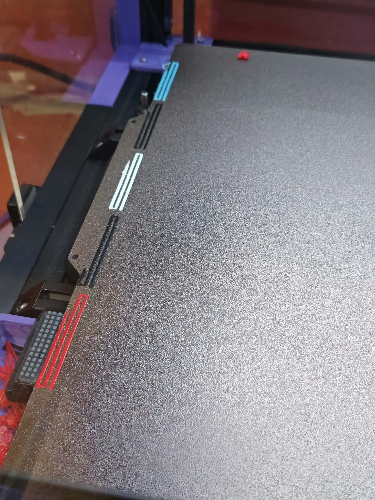
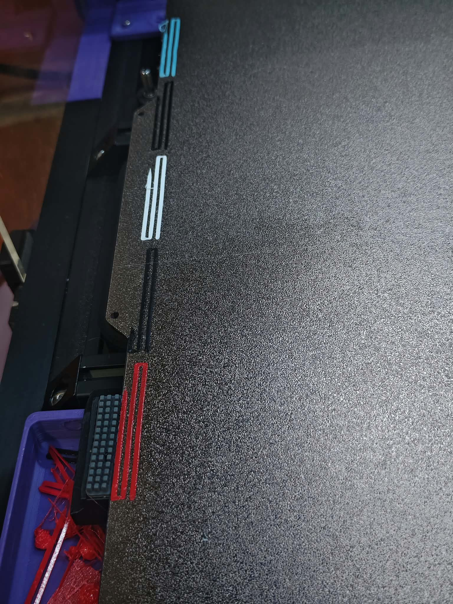

# Toolchanger Purge Lines — Klipper

Configurable multi-tool purge strokes, derived from Công Dương / IDcrazy123's prime-lines macro. Python 3.10+, standard library only for the builder. **Community revision 1.0.0 is experimental and has not yet been physically printed.** The two photos show the original machine macro, supplied by its operator.

## 1. Configure

Copy `profiles/printer.example.json` to `profiles/my-printer.local.json`. Review your actual printer and edit its clear purge rectangle, stroke axis, Z, speeds, flow, tool/extruder mapping and selection commands. Values are examples, not a printer preset; leave the example `reviewed=false`.

Each tool has an explicit entry recovery, parked retract and initial-tool retract. Match these with your tool-selection macros and slicer. Do not retract or recover the same amount twice. Only set `reviewed=true` in your actual profile after this review.

```text
python build_purge.py validate --profile profiles/my-printer.local.json
python build_purge.py build --profile profiles/my-printer.local.json -o output/prime-lines.cfg
```

Inspect the SVG and report. Solid lines extrude; dashed extensions are wipes. Slots follow ascending numeric tool ID along the chosen axis. Unused tools leave their slots empty. Wipe clearance is reserved at both ends; small areas shorten strokes and scale E. If the layout cannot fit, generation stops.

## 2. Install and connect

Back up your existing `prime-lines.cfg`. Upload the **generated** file to your Klipper config folder and include it once:

```ini
[include prime-lines.cfg]
```

Remove the previous `PRIME_LINES` definitions/include to avoid duplicate macro names. Save & Restart while idle. The provided `templates/prime-lines.template.cfg` is unreviewed and refuses to purge; it is only for reading the structure.

Your existing start macro must finish home/level/mesh and establish first-layer/tool offsets before this call. Pass temperatures only for tools used by the print:

```gcode
M220 S100
M221 S100
PRIME_LINES INITIAL_TOOL=2 T0_TEMP=230 T2_TEMP=230
```

This primes T0 first and T2 last, leaving T2 selected. Tn selection macros are reviewed machine contracts; an adapter such as `SELECT_TOOL T=2` can be specified in the profile. Named extruder heaters use native Klipper commands, avoiding assumptions about `M104 Tn` routing. The start macro and bed heating are not supplied or changed.

## 3. Test and return to printing

Clear the entire purge area and travel/dock route. Test one configured tool first, then the actual used-tool subset. The macro checks temperatures, mapping, flow section, homing and current coordinates, but cannot detect clips or objects or validate arbitrary toolchange macros.

**Exit contract:** initial tool remains mounted at `travel_z`, in `G90`, `M83`, `E=0`, still retracted by `initial_retract`. Your caller/slicer must recover that amount once and establish its expected E mode/origin before printing. Other tools remain retracted by their `parked_retract`; selection/slicer must recover those once. Heaters are left at initial print temperature or configured standby temperature.

See [CONFIGURATION](docs/CONFIGURATION.md), [SHARING_REVIEW](docs/SHARING_REVIEW.md), [VALIDATION](docs/VALIDATION.md), [SOURCES](docs/SOURCES.md) and [WORKFLOW](docs/WORKFLOW.md). This is a reviewed-profile toolkit, not a compatibility promise for every toolchanger firmware.

[Hướng dẫn tiếng Việt](README.vi.md).



